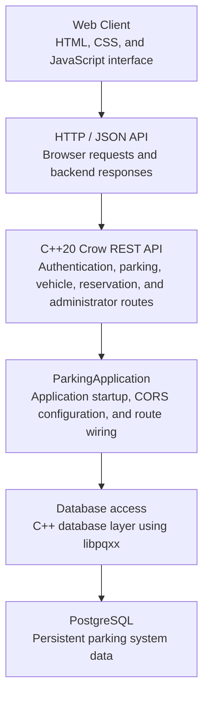
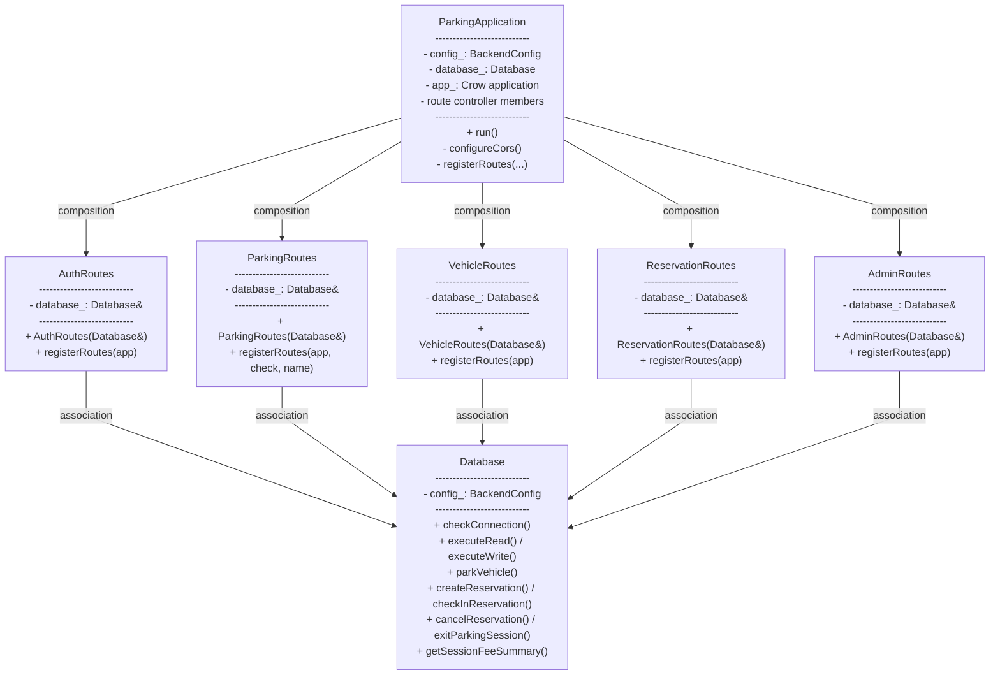

# Vehicle Parking Management System

A college project for managing vehicle parking through an HTML/CSS/JavaScript
frontend, a C++ backend using Crow, and a PostgreSQL database.

## Current development status

| Component | Status |
| --- | --- |
| Frontend | Authentication, parking availability, vehicles, reservations, active sessions, history, notifications, and administrator management implemented. |
| PostgreSQL | Schema implemented in [`database/schema.sql`](database/schema.sql), with migrations and seed scripts under `database/`. |
| C++ backend | OOP structure with a `ParkingApplication` composition root, route controller classes, and an encapsulated `Database` layer; provides bearer authentication, transactional reservations and sessions, billing, history, notifications, and administration. |
| REST API | Health, authentication, profile, parking availability, vehicles, reservations, sessions, history, notifications, and administrator endpoints implemented. |
| Frontend-backend integration | Browser `fetch` integration targets `http://localhost:3000`; live Phase 8 database end-to-end verification remains. |

The database schema does not by itself mean that the corresponding user-facing
features or CRUD operations are implemented.

## Technology stack

- HTML, CSS, and JavaScript frontend
- C++20 backend
- Crow, fetched by CMake
- PostgreSQL
- libpqxx for C++ to PostgreSQL access
- CMake and Ninja-compatible build configuration
- JSON responses from the Crow routes

## Diagrams

### System architecture



### UML class diagram



The editable TikZ versions of these diagrams are in [`diagrams.tex`](diagrams.tex).

Authentication, profiles, parking availability, vehicle management, basic
administrator management and maintenance, reservations, manual check-in and
exit, fee summaries, history, and in-app notifications are implemented.
Automated expiry, QR processing, online payment processing, and advanced
reporting remain planned.

## Implemented features

### Frontend

- Supports registration, login, and logout.
- Loads parking-area and slot availability.
- Adds and edits vehicles, shows compatible available slots, and parks a
  selected vehicle until checkout.
- Searches compatible slots by vehicle, area, location, slot type, EV charging,
  and requested time; creates, views, and cancels reservations.
- Shows active parking sessions, parking history with fee/payment summaries,
  paginated in-app notifications, unread count, and mark-as-read controls.
- Administrator console with user role/status controls, area management, slot
  configuration, pricing rates, and maintenance scheduling.
- Uses bearer-authenticated requests to the backend at port 3000.

### Backend

- Creates a Crow application with CORS middleware.
- Attempts a PostgreSQL connection to the `parking_management` database.
- Executes `SELECT 1` when the connection is established.
- Provides bearer-session authentication and profile operations.
- Loads parking areas and slots from PostgreSQL.
- Provides owner-scoped vehicle CRUD, compatible-slot selection, and checkout.
- Provides owner-scoped availability search and transaction-protected reservation
  creation, listing, details, and cancellation.
- Provides manual reservation check-in, session exit and fee calculation,
  user-scoped paginated history, and transactional in-app event notifications.
- Atomically claims/releases parking slots and persists assignment history.
- Provides administrator operations for users, areas, slots, rates, and maintenance
  with role-based access control (`admin` role enforcement).

### Database

- Defines the relational entities, keys, constraints, and indexes in [`database/schema.sql`](database/schema.sql).
- Uses `pgcrypto` and `gen_random_uuid()` for QR token generation.
- Defines primary keys, foreign keys, checks, unique constraints, and indexes.

## Planned features

The following are described in [planning.md](planning.md) but are not yet
implemented as complete application functionality:

- Automated reservation expiry
- QR-based check-in and vehicle entry
- Online payment processing, refunds, and digital receipts
- Advanced fee rules, external notifications, and reporting

## Actual project structure

```text
README.md                         Project overview, setup, and structure
API.md                            Implemented API reference and pending work
OOPS.md                           Object-oriented design notes
planning.md                       Requirements, progress, and next steps
PROMPTS.md                        Project prompt/history notes
diagrams.tex                      TikZ architecture and OOP diagrams
diagrams.pdf                      Compiled diagrams
18_VPMS.tex                       CS3104 mini-project report source
18_VPMS.pdf                       Compiled report
report_screenshots/               Screenshots embedded in the report
  *.png
backend/
  CMakeLists.txt                  CMake build configuration
  src/
    main.cpp                      Environment setup and application startup
    application/                  ParkingApplication lifecycle and dependency wiring
    api/                          Response and error helpers
    auth/                         Password and token utilities
    config/                       Environment configuration
    database/                     Database access and fee calculation
    routes/                       Auth, parking, reservation, vehicle, and admin controllers
    validation/                   Request validation
  tests/
    api_tests.cpp                 API response and route behavior tests
    auth_tests.cpp                Authentication tests
    config_tests.cpp              Configuration tests
    database_tests.cpp            Database tests
    admin_tests.cpp               Administrator operation tests
    validation_tests.cpp          Request validation tests
    parking_fee_tests.cpp         Fee calculation tests
database/
  schema.sql                      Base PostgreSQL schema
  phase*.sql, overtime.sql        Incremental migrations
  seed*.sql                       Development seed data
frontend/
  index.html                      Single-page application
  css/style.css                   Application styles
  js/                             API, auth, parking, vehicles, reservations, admin
  assets/images/                  Parking background and vehicle illustrations
```

Build output under `backend/build/` is generated and omitted from the source tree.

## Setup and running

### Frontend

Open `frontend/index.html` in a browser or serve the `frontend` directory with
a local static HTTP server. The page expects the backend at
`http://localhost:3000`.

### Database

Create a PostgreSQL database named `parking_management`, then run:

```text
psql -U <user> -d parking_management -f database/schema.sql
```

The schema file creates the `pgcrypto` extension and all 12 tables. Do not put
real passwords in documentation or source code.

For an existing database created before Phase 2 authentication, run the
repeatable migration:

```text
psql -U <user> -d parking_management -f database/phase2_auth.sql
```

Apply the Phase 3 parking-assignment migration after the schema, any Phase 2
migration, and any optional seed data, but before starting the updated backend:

```text
psql -U <user> -d parking_management -f database/phase3_vehicle_parking.sql
```

This migration creates the active parking-assignment table, clears seeded
`occupied` and `reserved` slot statuses when no active reservation/session/
assignment owns them, and deletes vehicle records that are not referenced by
reservation, session, or parking-assignment history. Linked vehicles and
historical records are preserved. Maintenance and unavailable slots are left
unchanged.

For an existing database, add the vehicle accessibility preference before
starting the updated backend:

```text
psql -U <user> -d parking_management -f database/phase6_accessible_parking.sql
```

This migration defaults existing vehicles to not requiring accessible parking.
Vehicles marked as requiring accessible parking may use handicapped slots;
other vehicles are not offered those slots.

For an existing database, add the planned stay end time used by immediate
parking and overtime billing before starting the updated backend:

```text
psql -U <user> -d parking_management -f database/overtime.sql
```

The migration backfills existing parking assignments using their elapsed
whole-hour duration. New immediate parking requests must include a planned
stay duration.

For local Phase 1 development data, run the repeatable seed script after the
schema:

```text
psql -U <user> -d parking_management -f database/seed_phase1.sql
```

The seed creates three Mall Central floor areas with 32 slots each. It includes
four truck slots, ten bike/scooter slots, twelve normal car slots, three EV
slots, and three handicapped slots per floor. It uses example availability
states and must not be used as production data.

### Backend

The backend requires CMake 3.20 or newer, a C++20 compiler, Crow, and
libpqxx. Configure and build from the `backend` directory using the existing
CMake configuration:

```text
cmake -S backend -B backend/build
cmake --build backend/build
```

Before starting the backend, configure the database password through the
environment. The other variables have local-development defaults:

```text
PARKING_DB_HOST=localhost
PARKING_DB_PORT=5432
PARKING_DB_NAME=parking_management
PARKING_DB_USER=postgres
PARKING_DB_PASSWORD=<your-local-password>
PARKING_SERVER_PORT=3000
```


On Windows PowerShell, for the current terminal session:

```powershell
$env:PARKING_DB_PASSWORD = "<your-local-password>"
```

Run the generated `parking_backend` executable. It listens on the configured
server port. The backend exits with a configuration error if
`PARKING_DB_PASSWORD` is missing or `PARKING_SERVER_PORT` is invalid.

## Documentation

- [planning.md](planning.md) — requirements, progress, and next steps
- [`database/schema.sql`](database/schema.sql) — PostgreSQL schema source
- `database/phase*.sql` — incremental database migrations
- [API.md](API.md) — implemented API routes and pending API work
- [OOPS.md](OOPS.md) — C++ object-oriented programming analysis

## Database model summary

The schema separates accounts and bearer sessions, vehicles, parking areas and slots,
parking assignments, reservations, parking sessions, rates, payments, maintenance,
QR tokens, receipts, and notifications. Foreign keys, uniqueness rules, checks, and
indexes live in `database/schema.sql` and its migrations; the SQL files are the
authoritative schema documentation.

## Limitations and next steps

The project has implemented the Version 1 core parking workflow through Phase 8.
Live database end-to-end verification for Phase 8 and production deployment
remain outstanding. Input validation, secrets management, and operational
hardening remain necessary before the system can be considered complete.
